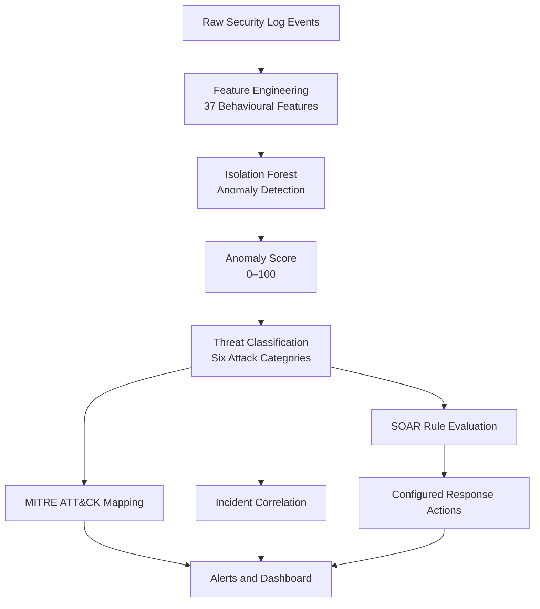

<div align="center">


# AI Threat Hunting & Incident Response Platform

**An ML-powered security operations platform for behavioural threat detection, incident correlation, and automated response orchestration.**

[](https://python.org)
[](https://fastapi.tiangolo.com)
[](https://react.dev)
[](https://docker.com)
[](https://postgresql.org)
[](https://scikit-learn.org)
[](LICENSE)
[](#testing)


</div>

---

## Overview

Traditional security monitoring can generate large volumes of alerts that analysts must investigate individually. **AI Threat Hunting & Incident Response Platform** explores how machine learning, behavioural threat classification, incident correlation, and Security Orchestration, Automation and Response (SOAR) can work together to streamline security operations.

The platform processes security log events, assigns anomaly scores, identifies suspicious behaviour, correlates related threats, and evaluates configured response rules. A React-based Security Operations Center (SOC) dashboard presents the results in an interactive interface.

> **Project scope:** Detection and response results depend on the implemented rules, synthetic data, and configured integrations. Treat the platform as a security engineering project and validate all response actions before using it in a real environment.

## Key Capabilities

| Capability | Implementation |
|---|---|
| Anomaly detection | Isolation Forest model trained on 5,000 synthetic normal events |
| Behavioural analysis | 37 engineered features for identifying suspicious activity |
| Threat classification | Rule-based classification across six attack scenarios |
| Threat intelligence mapping | MITRE ATT&CK technique references |
| Response orchestration | SOAR rule engine with 10 configured response rules |
| Incident correlation | Groups related threats into potential campaigns |
| Geographic visualization | Leaflet-based map for threat-origin information |
| SOC monitoring | React dashboard with Chart.js visualizations |
| Data infrastructure | PostgreSQL persistence and Redis caching/cooldowns |
| Deployment | Docker Compose with separate application services |

## System Architecture

The platform uses a containerized architecture that separates the user interface, API, detection pipeline, and data infrastructure.

```text
                    ┌─────────────────────────────┐
  Browser           │       Docker Network        │
    │               │                             │
    ▼ :3000         │                             │
  ┌─────────────┐   │   ┌────────────────────┐    │
  │   React     │───┼──▶│   FastAPI :8000    │    │
  │  Dashboard  │   │   │                    │    │
  │  Chart.js   │   │   │  IsolationForest   │    │
  │  Leaflet.js │   │   │  ThreatClassifier  │    │
  └─────────────┘   │   │  SOAR RuleEngine   │    │
                    │   │  IncidentCorrelator│    │
                    │   └────────┬───────────┘    │
                    │            │                │
                    │   ┌────────┴────────┐       │
                    │   │                 │       │
                    │   │ PostgreSQL :5432│       │
                    │   │ Redis :6379     │       │
                    │   │ logs/threats/   │       │
                    │   │ alerts/cache    │       │
                    │   └─────────────────┘       │
                    └─────────────────────────────┘
```

### Component Responsibilities

- **Frontend:** Displays threats, severity distributions, timelines, alerts, and geographic visualizations.
- **API layer:** Accepts incoming events, exposes threat and alert endpoints, and coordinates backend operations.
- **ML pipeline:** Converts log events into behavioural features and evaluates anomalous activity.
- **Threat classifier:** Assigns suspicious events to supported attack categories and maps relevant MITRE ATT&CK techniques.
- **Incident correlator:** Connects related events to support investigation of multi-stage activity.
- **SOAR engine:** Evaluates response rules and invokes the corresponding configured actions.
- **PostgreSQL:** Persists security events, detected threats, and alert information.
- **Redis:** Supports application caching and cooldown mechanisms.

## Machine Learning & Threat Detection

The detection pipeline combines unsupervised anomaly detection with a rule-based threat classifier.



### 1. Feature Engineering

The pipeline extracts 37 behavioural features from security events. Examples include:

- Failed-login rates and authentication patterns
- Password-spray indicators and unique-user counts
- Sensitive-file access and bytes read
- Request timing and access frequency
- Cyclical time features such as `hour_sin` and `hour_cos`

These features provide the numerical representation used by the detection pipeline.

### 2. Isolation Forest Anomaly Detection

The Isolation Forest model learns patterns from a training dataset containing 5,000 synthetic normal events. It identifies events that deviate from those learned patterns.

The application converts its anomaly output into a score on a **0–100 scale**, where higher scores indicate greater anomalousness according to the implemented scoring logic.

### 3. Behavioural Threat Classification

A rule-based classifier assigns suspicious events to attack categories and associates relevant techniques with MITRE ATT&CK.

| Attack category | Example ATT&CK technique |
|---|---|
| Brute force | T1110.001 — Password Guessing |
| Privilege escalation | T1548.003 — Sudo and Sudo Caching |
| Data exfiltration | T1005 — Data from Local System |
| Password spray | T1110.003 — Password Spraying |
| Suspicious login | Context-dependent technique mapping |
| Automated scanner | Context-dependent technique mapping |

Technique associations should be interpreted in the context of observed behaviour; they are not proof that an attack occurred.

### 4. Detection Evaluation

The following are the reported results from the project's synthetic test scenarios.

| Attack scenario | Average anomaly score | Reported severity |
|---|---:|---|
| Brute force | 100.0 | Critical |
| Privilege escalation | 98.5 | Critical |
| Data exfiltration | 86.4 | Critical |
| Suspicious login | 86.1 | High |
| Password spray | 79.3 | High |
| Automated scanner | 68.7 | Medium |

**Reported ROC-AUC: 0.89 on the synthetic test set.**

These values describe the current synthetic evaluation, not independently validated real-world detection performance. Results depend on the dataset, feature engineering, scoring calibration, and evaluation methodology.

## SOAR: Automated Response Orchestration

The response engine evaluates threat conditions and selects configured actions. Its objective is to reduce repetitive manual response work and provide a consistent workflow for security events.

| Threat scenario | Example trigger | Configured response |
|---|---|---|
| Brute force | More than 20 failed logins | Block IP, disable user, send alert |
| Privilege escalation | Administrative activity spike and sensitive-file access | Disable user, quarantine host, rotate credentials |
| Data exfiltration | More than 5 MB read with sensitive-data indicators | Block IP, rate-limit user |
| Password spray | More than five unique users from one IP | Block IP, send alert |
| Suspicious login | High-risk country and missing MFA | Enforce MFA, disable user |
| Automated scanner | Requests occurring at intervals under one second | Rate-limit IP to two requests per minute |

The project defines **10 response rules and eight SOAR action types**.

### Response Workflow

1. Receive and analyze a security event.
2. Classify the detected behaviour and determine its severity.
3. Evaluate applicable response rules.
4. Invoke the configured response actions.
5. Record alert and response information for investigation.

> **Deployment note:** Actions such as blocking an IP, disabling an account, or quarantining a host require appropriate integrations and permissions to affect external infrastructure. Verify which actions are simulated, logged, or connected to real enforcement systems in your deployment before treating them as operational controls.

## Incident Correlation

Individual alerts do not always reveal the complete picture. The incident correlator groups related threat events into potential campaigns, helping analysts investigate sequences of suspicious activity.

For example, repeated authentication failures followed by a suspicious login, privilege escalation, and sensitive-file access may warrant investigation as a related incident.

Correlation supports investigation; a shared IP address or temporal relationship alone does not establish that multiple events belong to the same attacker.

## SOC Dashboard

The React dashboard provides a unified view of detected threats and security activity.

- **Threat overview:** View current threat counts and security statistics.
- **Timeline analysis:** Explore changes in detected activity over time.
- **Severity distribution:** Compare critical, high, and medium threats.
- **Threat categorization:** Understand the distribution of attack types.
- **Geographic visualization:** Explore threat-origin data on a world map.
- **Alert management:** Review alerts and acknowledge or resolve them.
- **Rule visibility:** Inspect configured response rules and their status.

The interface uses React 18, Chart.js, Leaflet, Vite, and Nginx.

## API Reference

The FastAPI service exposes REST endpoints for event ingestion, threat investigation, alert management, and attack simulation.

| Method | Endpoint | Purpose |
|---|---|---|
| `GET` | `/api/v1/stats` | Retrieve dashboard statistics |
| `GET` | `/api/v1/threats` | Retrieve detected threats |
| `GET` | `/api/v1/alerts` | Retrieve security alerts |
| `GET` | `/api/v1/rules` | Retrieve response rules |
| `POST` | `/api/v1/ingest` | Ingest raw log events |
| `POST` | `/api/v1/simulate_attack` | Simulate a supported attack scenario |
| `POST` | `/api/v1/alerts/{id}/acknowledge` | Acknowledge an alert |
| `POST` | `/api/v1/alerts/{id}/resolve` | Resolve an alert |

Interactive API documentation is available at `/docs` when the backend is running.

### Example: Simulating an Attack

```http
POST /api/v1/simulate_attack
Content-Type: application/json
```

```json
{
  "attack_type": "brute_force",
  "geo_country": "RU",
  "intensity": "high",
  "dry_run": true
}
```

The example uses `dry_run: true` to illustrate a safer simulation workflow. Supported attack types include brute force, privilege escalation, data exfiltration, password spray, suspicious login, and automated scanning.

Use only authorized test environments and verify the API's actual simulation and dry-run semantics before testing response behaviour.

## Technology Stack

| Layer | Technologies |
|---|---|
| Backend | Python 3.11, FastAPI, Uvicorn |
| Machine learning | scikit-learn, pandas, NumPy, joblib |
| Classification | Custom rule-based threat classifier |
| Frontend | React 18, Vite, Chart.js, Leaflet |
| Database | PostgreSQL 16, SQLAlchemy, asyncpg |
| Caching | Redis 7 |
| Infrastructure | Docker, Docker Compose, Nginx |
| Security concepts | MITRE ATT&CK, anomaly detection, SOAR, SOC workflows |

## Project Structure

```text
ai-threat-hunting-platform/
├── backend/
│   ├── api/
│   │   ├── main.py
│   │   ├── store.py
│   │   └── schemas.py
│   ├── ml/
│   │   ├── anomaly/
│   │   └── classifier/
│   ├── incident_response/
│   │   ├── actions.py
│   │   ├── rule_engine.py
│   │   └── correlator.py
│   ├── log_simulator/
│   └── tests/
├── dashboard/
│   └── src/
│       └── SOCDashboard.jsx
├── docker/
│   ├── backend.Dockerfile
│   ├── frontend.Dockerfile
│   ├── nginx.conf
│   └── postgres/
│       └── init.sql
├── docker-compose.yml
├── .env.example
├── Makefile
└── README.md
```

## Getting Started

### Prerequisites

- Docker Desktop or Docker Engine
- Docker Compose
- Git

### 1. Clone the Repository

```bash
git clone https://github.com/Varunpv2005/ai-threat-hunting-platform.git
cd ai-threat-hunting-platform
```

### 2. Configure Environment Variables

```bash
cp .env.example .env
```

Review `.env` and configure the required database credentials, application secret, and model-training settings.

### 3. Build and Launch

```bash
docker compose up -d --build
```

### 4. Check the Backend

```bash
docker compose logs -f backend
```

Wait until model initialization completes and the API reports that it is ready. Use the actual backend service name defined in your `docker-compose.yml` if it differs from `backend`.

### 5. Open the Application

| Service | URL |
|---|---|
| SOC dashboard | http://localhost:3000 |
| Interactive API documentation | http://localhost:8000/docs |
| API OpenAPI schema | http://localhost:8000/openapi.json |

These URLs assume the default local port mappings are configured in `docker-compose.yml`.

## Testing

The project includes tests for API behaviour and SOAR rule evaluation.

Run the API integration test module using the service name and test path configured in your repository. For example, if the service is named `soc_backend`:

```bash
docker compose exec soc_backend python backend/tests/test_api.py
```

Run the rule-engine test suite using the corresponding test module or command defined in your repository.

The reported test results are:

| Test suite | Reported result |
|---|---:|
| API integration | 40 passed |
| SOAR rule engine | 57 passed |
| **Total** | **97 reported passing tests** |

Re-run the complete test suite after making changes. Test counts indicate coverage of implemented behaviours, not proof that every production failure mode has been addressed.

## Environment Configuration

The following variables are documented as example settings. Confirm the actual defaults in your `.env.example` and application configuration.

| Variable | Example default | Purpose |
|---|---|---|
| `POSTGRES_PASSWORD` | `socpassword` | PostgreSQL authentication |
| `REDIS_PASSWORD` | `redispass` | Redis authentication |
| `SECRET_KEY` | Placeholder | Application secret |
| `TRAIN_ON_STARTUP` | `true` | Enable model training at startup |
| `N_TRAIN_EVENTS` | `5000` | Number of training events |
| `WORKERS` | `2` | Uvicorn worker configuration |

**Security:** These example values are for local development only. Use strong, unique secrets, restrict network exposure, and configure production-grade authentication and authorization before deploying outside a trusted test environment.

## Current Limitations & Roadmap

The following are planned enhancements rather than features to assume are already implemented:

- [ ] Evaluate a supervised XGBoost classifier against the existing baseline.
- [ ] Add JWT authentication and role-based access control.
- [ ] Implement WebSocket-based real-time alert delivery.
- [ ] Integrate with Elasticsearch or another SIEM platform.
- [ ] Add Slack and email notifications.
- [ ] Deploy to a cloud environment with production security controls.
- [ ] Evaluate detection quality on representative, independently labelled security data.
- [ ] Add integration tests for external response actions and failure recovery.

## Learning Outcomes

This project brings together several practical engineering areas:

- Designing REST APIs with FastAPI.
- Building a behavioural anomaly-detection pipeline with scikit-learn.
- Engineering features from security event data.
- Modelling and persisting security events using PostgreSQL.
- Implementing caching and cooldown mechanisms with Redis.
- Building interactive monitoring interfaces using React.
- Containerizing multi-service applications with Docker Compose.
- Applying MITRE ATT&CK concepts to threat classification and incident investigation.
- Designing rule-based security response workflows.

## Author

**Varun P V**  
Computer Science and Engineering Student

- GitHub: [@Varunpv2005](https://github.com/Varunpv2005)
- Project repository: [AI Threat Hunting & Incident Response Platform](https://github.com/Varunpv2005/ai-threat-hunting-platform)

## License

This project is licensed under the MIT License. See the [LICENSE](LICENSE) file for the applicable terms.

---

*Built as a cybersecurity engineering project exploring the integration of machine learning, threat analysis, and security response automation.*
