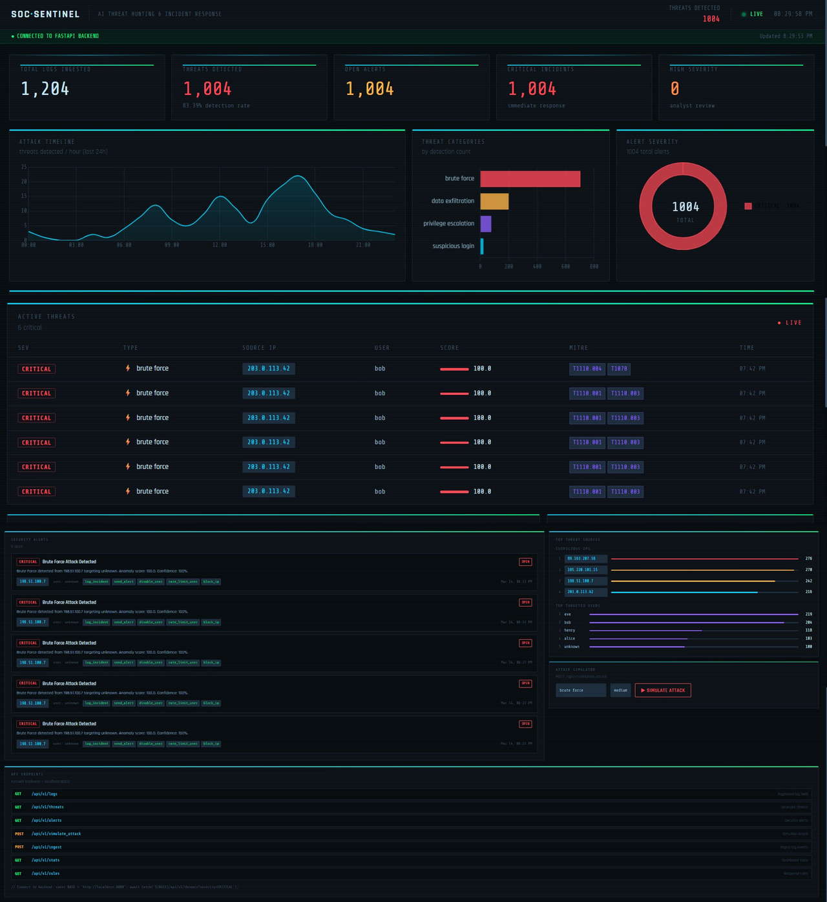
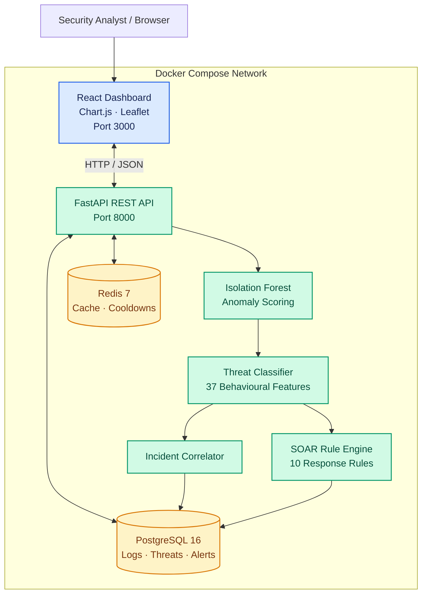
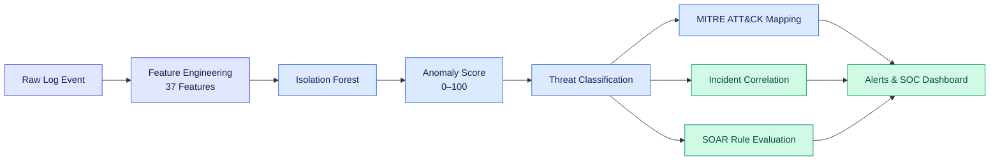

<div align="center">


# AI Threat Hunting & Incident Response Platform

**An ML-powered security operations platform for behavioural threat detection, incident correlation, and automated response orchestration.**

[](https://python.org)
[](https://fastapi.tiangolo.com)
[](https://react.dev)
[](https://docker.com)
[](https://postgresql.org)
[](https://scikit-learn.org)
[](LICENSE)
[](#testing)



</div>

---

## Overview

Security teams often face large volumes of events that require
investigation. This project demonstrates a workflow for analysing log
events, identifying anomalous behaviour, classifying suspicious
activity, correlating related threats, and evaluating automated response
rules in one SOC-style application.

### At a glance

  -----------------------------------------------------------------------
  Capability                          Implementation
  ----------------------------------- -----------------------------------
  Anomaly detection                   Isolation Forest trained on 5,000
                                      synthetic normal events

  Behavioural features                37 engineered features

  Threat classification               Rule-based classifier covering six
                                      attack scenarios

  Threat mapping                      MITRE ATT&CK technique references

  Response orchestration              10 configured SOAR rules

  Incident correlation                Groups related threats into
                                      potential campaigns

  Dashboard                           React, Chart.js, and Leaflet

  Data services                       PostgreSQL and Redis

  Deployment                          Docker Compose
  -----------------------------------------------------------------------

## Architecture

The original high-level architecture is retained below, with the
application components and data stores made explicit. The Mermaid
diagram is rendered by GitHub when the code fence is preserved exactly.



### Component responsibilities

-   **React dashboard:** Displays threat statistics, timelines, severity
    distribution, alerts, and geographic visualizations.
-   **FastAPI:** Exposes endpoints for event ingestion, threat
    retrieval, alert management, and attack simulation.
-   **Detection pipeline:** Extracts behavioural features and scores
    anomalous events.
-   **Threat classifier:** Applies rule-based logic to categorize
    suspicious activity and associate relevant ATT&CK techniques.
-   **Incident correlator:** Groups related events to support
    multi-stage investigation.
-   **SOAR rule engine:** Evaluates configured conditions and invokes
    the corresponding response actions.
-   **PostgreSQL:** Stores application security data.
-   **Redis:** Supports caching and cooldown behaviour.

## Detection Pipeline



### 1. Feature engineering

The pipeline uses 37 behavioural features. Examples include failed-login
rates, password-spray indicators, unique users per IP, bytes read,
sensitive-file activity, request timing, and cyclical time features such
as `hour_sin` and `hour_cos`.

### 2. Anomaly detection

The Isolation Forest model is trained on 5,000 synthetic normal events.
Its output is converted by the application into a 0--100 anomaly score;
higher values indicate greater anomalousness according to the project's
scoring logic.

### 3. Threat classification

The rule-based classifier categorizes suspicious activity into six
scenarios and associates relevant MITRE ATT&CK technique references.

  Attack scenario        Example ATT&CK mapping
  ---------------------- -------------------------------------
  Brute force            T1110.001 --- Password Guessing
  Privilege escalation   T1548.003 --- Sudo and Sudo Caching
  Data exfiltration      T1005 --- Data from Local System
  Password spray         T1110.003 --- Password Spraying
  Suspicious login       Context-dependent mapping
  Automated scanner      Context-dependent mapping

Mappings are contextual references, not proof that an attack occurred.

### 4. Reported synthetic evaluation

  Attack scenario          Average anomaly score Reported severity
  ---------------------- ----------------------- -------------------
  Brute force                              100.0 Critical
  Privilege escalation                      98.5 Critical
  Data exfiltration                         86.4 Critical
  Suspicious login                          86.1 High
  Password spray                            79.3 High
  Automated scanner                         68.7 Medium

**Reported ROC-AUC: 0.89 on the synthetic test set.**

These are project-reported synthetic-data results, not independently
validated real-world performance. The evaluation should be reproducible
from the dataset, labels, split strategy, and metric calculation used in
the repository.

## SOAR Response Engine

The rule engine evaluates threat conditions and selects configured
response actions.

  -----------------------------------------------------------------------
  Scenario                Example trigger         Configured action
  ----------------------- ----------------------- -----------------------
  Brute force             More than 20 failed     Block IP, disable user,
                          logins                  send alert

  Privilege escalation    Admin activity spike    Disable user,
                          plus sensitive-file     quarantine host, rotate
                          access                  credentials

  Data exfiltration       More than 5 MB read     Block IP, rate-limit
                          plus sensitive-data     user
                          indicators              

  Password spray          More than five unique   Block IP, send alert
                          users from one IP       

  Suspicious login        High-risk country and   Enforce MFA, disable
                          no MFA                  user

  Automated scanner       Requests less than one  Rate-limit IP to 2
                          second apart            requests/minute
  -----------------------------------------------------------------------

The project defines 10 response rules and eight action types.

### Response flow

1.  Ingest and analyse a security event.
2.  Score and classify suspicious behaviour.
3.  Evaluate the applicable response rules.
4.  Invoke the configured response action.
5.  Record the alert and response information for investigation.

> **Operational note:** Actions such as blocking an IP, disabling an
> account, or quarantining a host affect real infrastructure only when
> the relevant integrations, permissions, and enforcement mechanisms are
> implemented. Verify which actions in this repository are simulated
> versus operational.

## Incident Correlation

The correlator groups related threat events into potential campaigns to
help analysts investigate activity across multiple stages. For example,
repeated authentication failures followed by a suspicious login,
privilege escalation, and sensitive-file access may warrant
investigation as a connected sequence.

Correlation is an investigative aid; a shared IP or close timestamp
alone does not prove that events belong to the same attacker.

## SOC Dashboard

The React dashboard brings key security information into one interface:

-   **Threat overview:** Current threat counts and summary statistics.
-   **Timeline:** Activity over time.
-   **Severity distribution:** Critical, high, and medium threat
    breakdown.
-   **Threat categories:** Distribution of detected attack types.
-   **Geographic view:** Threat-origin information displayed on a
    Leaflet map.
-   **Alert management:** Acknowledge and resolve alerts.
-   **Rule visibility:** Inspect configured SOAR rules.

> **Screenshot tip:** Keep `screenshots/dashboard.png` only if that file
> exists in the repository. A real screenshot of the running application
> is more valuable to recruiters than a mockup.

## API Reference

Interactive documentation is available at `http://localhost:8000/docs`
after startup.

  Method   Endpoint                            Purpose
  -------- ----------------------------------- -----------------------------
  `GET`    `/api/v1/stats`                     Dashboard statistics
  `GET`    `/api/v1/threats`                   Detected threats
  `GET`    `/api/v1/alerts`                    Security alerts
  `GET`    `/api/v1/rules`                     Configured response rules
  `POST`   `/api/v1/ingest`                    Ingest log events
  `POST`   `/api/v1/simulate_attack`           Simulate a supported attack
  `POST`   `/api/v1/alerts/{id}/acknowledge`   Acknowledge an alert
  `POST`   `/api/v1/alerts/{id}/resolve`       Resolve an alert

### Example: attack simulation

``` http
POST /api/v1/simulate_attack
Content-Type: application/json
```

``` json
{
  "attack_type": "brute_force",
  "geo_country": "RU",
  "intensity": "high",
  "dry_run": true
}
```

Use only an authorized test environment. Confirm the endpoint's accepted
values and the actual meaning of `dry_run` in the implementation before
relying on it.

## Technology Stack

  -----------------------------------------------------------------------
  Layer                               Technologies
  ----------------------------------- -----------------------------------
  Backend                             Python 3.11, FastAPI, Uvicorn

  Machine learning                    scikit-learn, pandas, NumPy, joblib

  Frontend                            React 18, Vite, Chart.js, Leaflet

  Database                            PostgreSQL 16, SQLAlchemy, asyncpg

  Cache                               Redis 7

  Deployment                          Docker, Docker Compose, Nginx

  Security concepts                   MITRE ATT&CK, anomaly detection,
                                      SOAR, SOC workflows
  -----------------------------------------------------------------------

## Repository Structure

``` text
ai-threat-hunting-platform/
├── backend/
│   ├── api/
│   │   ├── main.py
│   │   ├── store.py
│   │   └── schemas.py
│   ├── ml/
│   │   ├── anomaly/
│   │   └── classifier/
│   ├── incident_response/
│   │   ├── actions.py
│   │   ├── rule_engine.py
│   │   └── correlator.py
│   ├── log_simulator/
│   └── tests/
├── dashboard/
│   └── src/
│       └── SOCDashboard.jsx
├── docker/
│   ├── backend.Dockerfile
│   ├── frontend.Dockerfile
│   ├── nginx.conf
│   └── postgres/
│       └── init.sql
├── docker-compose.yml
├── .env.example
├── Makefile
└── README.md
```

## Quick Start

### Prerequisites

-   Git
-   Docker Desktop or Docker Engine
-   Docker Compose

### 1. Clone the repository

``` bash
git clone https://github.com/Varunpv2005/ai-threat-hunting-platform.git
cd ai-threat-hunting-platform
```

### 2. Configure the environment

``` bash
cp .env.example .env
```

Review `.env` and configure the required credentials, application
secret, and model-training settings. Replace development passwords
before exposing the application beyond a local environment.

### 3. Build and launch

``` bash
docker compose up -d --build
```

### 4. Inspect service startup

``` bash
docker compose ps
docker compose logs -f backend
```

Use the actual service names defined in `docker-compose.yml` if they
differ from `backend`.

### 5. Open the application

  --------------------------------------------------------------------------
  Service                             Local URL
  ----------------------------------- --------------------------------------
  SOC dashboard                       <http://localhost:3000>

  FastAPI docs                        <http://localhost:8000/docs>

  OpenAPI schema                      <http://localhost:8000/openapi.json>
  --------------------------------------------------------------------------

These URLs assume the corresponding ports are published by Docker
Compose.

## Tests

The project reports 97 passing tests across the API integration and
rule-engine suites.

``` bash
docker compose exec soc_backend \
  python backend/tests/test_api.py
```

The command above is the reported API test command; confirm the service
name and test paths against the current repository. Run the rule-engine
tests using the command defined by the project.

-   API integration tests: **40 reported passing**
-   Rule-engine tests: **57 reported passing**

Re-run the suites against the current code before relying on these
counts.

## Environment Variables

  Variable              Example default   Purpose
  --------------------- ----------------- --------------------------------
  `POSTGRES_PASSWORD`   `socpassword`     PostgreSQL password
  `REDIS_PASSWORD`      `redispass`       Redis password
  `SECRET_KEY`          Placeholder       Application secret
  `TRAIN_ON_STARTUP`    `true`            Train the model during startup
  `N_TRAIN_EVENTS`      `5000`            Number of training events
  `WORKERS`             `2`               Uvicorn worker configuration

**Security:** Example credentials are for local development only. Use
strong secrets, avoid committing real `.env` values, and add
authentication, authorization, and network restrictions before
production deployment.

## Roadmap

-   [ ] Compare a supervised XGBoost classifier with the existing
    baseline.
-   [ ] Add JWT authentication and role-based access control.
-   [ ] Implement WebSocket-based real-time alert delivery.
-   [ ] Integrate with Elasticsearch or another SIEM.
-   [ ] Add Slack and email notifications.
-   [ ] Deploy to a cloud environment with appropriate security
    controls.
-   [ ] Evaluate detection performance on representative, labelled
    security data.
-   [ ] Test external response integrations and failure recovery.

## Engineering Highlights

-   REST API development with FastAPI.
-   Behavioural feature engineering and unsupervised anomaly detection.
-   Rule-based threat classification and ATT&CK mapping.
-   Incident correlation and response orchestration.
-   PostgreSQL persistence and Redis caching.
-   Interactive React-based security visualizations.
-   Multi-service containerization with Docker Compose.

## Author

**Varun P V** · Computer Science and Engineering Student

-   GitHub: [@Varunpv2005](https://github.com/Varunpv2005)
-   Repository: [AI Threat Hunting & Incident Response
    Platform](https://github.com/Varunpv2005/ai-threat-hunting-platform)

## License

This project is distributed under the MIT License. See
[`LICENSE`](LICENSE) for details.

------------------------------------------------------------------------

```{=html}
<p align="center">
```
`<sub>`{=html}Built to explore machine learning, threat hunting, and
security response automation.`</sub>`{=html}
```{=html}
</p>
```
